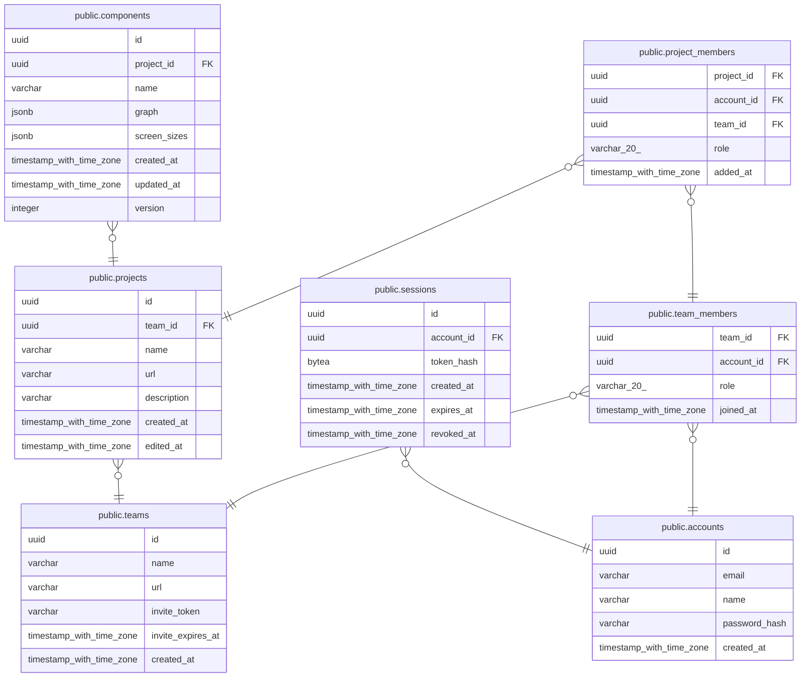

# Compono

## Tables

| Name | Columns | Comment | Type |
| ---- | ------- | ------- | ---- |
| [public.accounts](public.accounts.md) | 5 |  | BASE TABLE |
| [public.teams](public.teams.md) | 6 |  | BASE TABLE |
| [public.projects](public.projects.md) | 7 |  | BASE TABLE |
| [public.sessions](public.sessions.md) | 6 |  | BASE TABLE |
| [public.team_members](public.team_members.md) | 4 |  | BASE TABLE |
| [public.components](public.components.md) | 8 |  | BASE TABLE |
| [public.project_members](public.project_members.md) | 5 |  | BASE TABLE |

## Relations

---

> Generated by [tbls](https://github.com/k1LoW/tbls)
