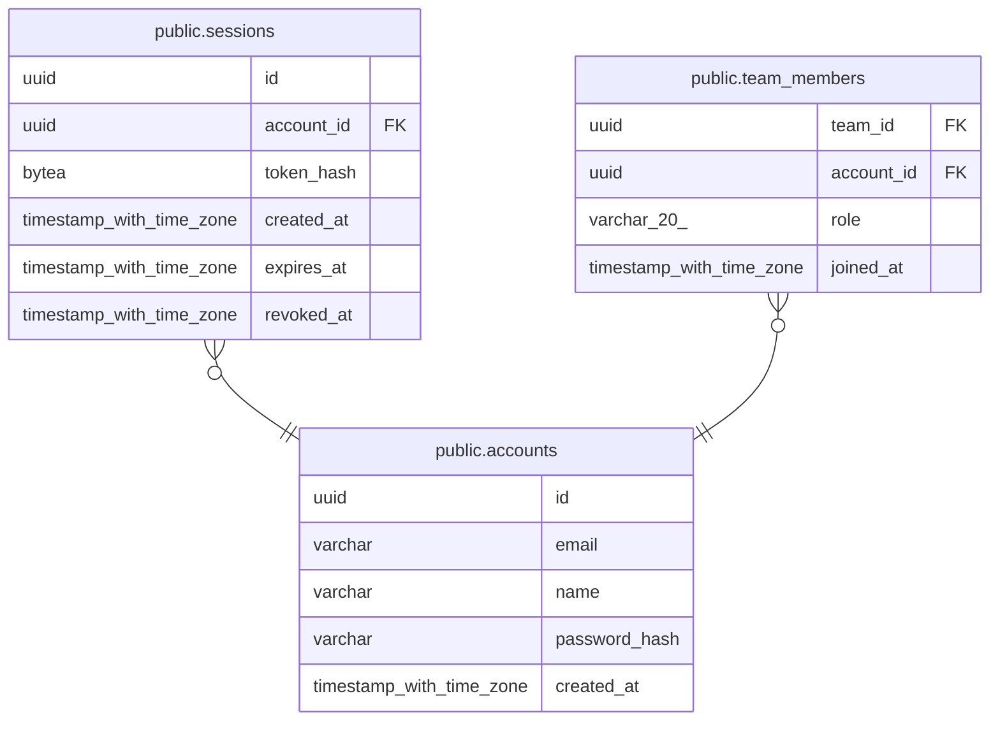

# public.accounts

## Columns

| Name | Type | Default | Nullable | Children |
| ---- | ---- | ------- | -------- | -------- |
| id | uuid | uuidv7() | false | [public.sessions](public.sessions.md) [public.team_members](public.team_members.md) |
| email | varchar |  | false |  |
| name | varchar |  | false |  |
| password_hash | varchar |  | false |  |
| created_at | timestamp with time zone | now() | false |  |

## Constraints

| Name | Type | Definition |
| ---- | ---- | ---------- |
| accounts_created_at_not_null | n | NOT NULL created_at |
| accounts_email_not_null | n | NOT NULL email |
| accounts_id_not_null | n | NOT NULL id |
| accounts_name_not_null | n | NOT NULL name |
| accounts_password_hash_not_null | n | NOT NULL password_hash |
| ck_accounts_email_lowercase | CHECK | CHECK (((email)::text = lower((email)::text))) |
| ck_accounts_name_not_blank | CHECK | CHECK ((btrim((name)::text) <> ''::text)) |
| pk_accounts | PRIMARY KEY | PRIMARY KEY (id) |
| uq_accounts_email | UNIQUE | UNIQUE (email) |

## Indexes

| Name | Definition |
| ---- | ---------- |
| pk_accounts | CREATE UNIQUE INDEX pk_accounts ON public.accounts USING btree (id) |
| uq_accounts_email | CREATE UNIQUE INDEX uq_accounts_email ON public.accounts USING btree (email) |

## Relations

---

> Generated by [tbls](https://github.com/k1LoW/tbls)
