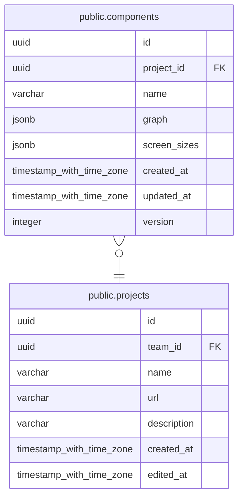

# public.components

## Columns

| Name | Type | Default | Nullable | Parents |
| ---- | ---- | ------- | -------- | ------- |
| id | uuid | uuidv7() | false |  |
| project_id | uuid |  | false | [public.projects](public.projects.md) |
| name | varchar |  | false |  |
| graph | jsonb |  | false |  |
| screen_sizes | jsonb |  | false |  |
| created_at | timestamp with time zone | now() | false |  |
| updated_at | timestamp with time zone | now() | false |  |
| version | integer |  | false |  |

## Constraints

| Name | Type | Definition |
| ---- | ---- | ---------- |
| ck_components_graph_object | CHECK | CHECK ((jsonb_typeof(graph) = 'object'::text)) |
| ck_components_name_format | CHECK | CHECK (((name)::text ~ '^[A-Z][A-Za-z0-9]*$'::text)) |
| ck_components_name_length | CHECK | CHECK ((char_length((name)::text) <= 64)) |
| ck_components_screen_sizes_not_empty | CHECK | CHECK (((jsonb_typeof(screen_sizes) = 'array'::text) AND (screen_sizes <> '[]'::jsonb))) |
| ck_components_version_positive | CHECK | CHECK ((version >= 1)) |
| components_created_at_not_null | n | NOT NULL created_at |
| components_graph_not_null | n | NOT NULL graph |
| components_id_not_null | n | NOT NULL id |
| components_name_not_null | n | NOT NULL name |
| components_project_id_not_null | n | NOT NULL project_id |
| components_screen_sizes_not_null | n | NOT NULL screen_sizes |
| components_updated_at_not_null | n | NOT NULL updated_at |
| components_version_not_null | n | NOT NULL version |
| fk_components_project_id_projects | FOREIGN KEY | FOREIGN KEY (project_id) REFERENCES projects(id) ON DELETE CASCADE |
| pk_components | PRIMARY KEY | PRIMARY KEY (id) |

## Indexes

| Name | Definition |
| ---- | ---------- |
| pk_components | CREATE UNIQUE INDEX pk_components ON public.components USING btree (id) |
| uq_components_project_id_name | CREATE UNIQUE INDEX uq_components_project_id_name ON public.components USING btree (project_id, lower((name)::text)) |

## Relations

---

> Generated by [tbls](https://github.com/k1LoW/tbls)
