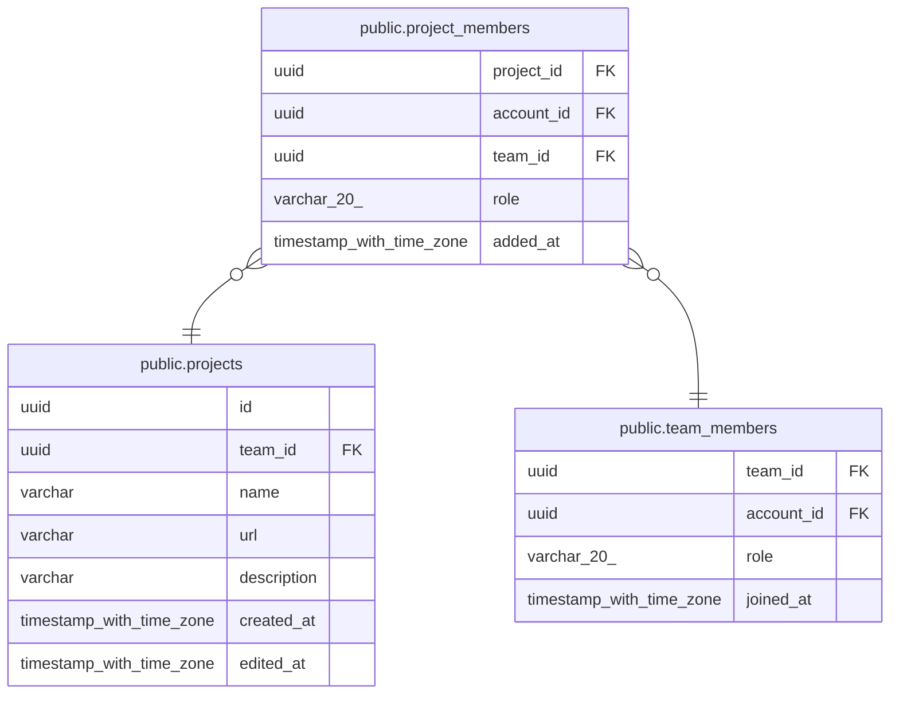

# public.project_members

## Columns

| Name | Type | Default | Nullable | Parents |
| ---- | ---- | ------- | -------- | ------- |
| project_id | uuid |  | false | [public.projects](public.projects.md) |
| account_id | uuid |  | false | [public.team_members](public.team_members.md) |
| team_id | uuid |  | false | [public.projects](public.projects.md) [public.team_members](public.team_members.md) |
| role | varchar(20) |  | false |  |
| added_at | timestamp with time zone | now() | false |  |

## Constraints

| Name | Type | Definition |
| ---- | ---- | ---------- |
| ck_project_members_role | CHECK | CHECK (((role)::text = ANY ((ARRAY['LEAD'::character varying, 'DEVELOPER'::character varying])::text[]))) |
| project_members_account_id_not_null | n | NOT NULL account_id |
| project_members_added_at_not_null | n | NOT NULL added_at |
| project_members_project_id_not_null | n | NOT NULL project_id |
| project_members_role_not_null | n | NOT NULL role |
| project_members_team_id_not_null | n | NOT NULL team_id |
| fk_project_members_project_id_team_id_projects | FOREIGN KEY | FOREIGN KEY (project_id, team_id) REFERENCES projects(id, team_id) ON DELETE CASCADE |
| fk_project_members_team_id_account_id_team_members | FOREIGN KEY | FOREIGN KEY (team_id, account_id) REFERENCES team_members(team_id, account_id) ON DELETE CASCADE |
| pk_project_members | PRIMARY KEY | PRIMARY KEY (project_id, account_id) |

## Indexes

| Name | Definition |
| ---- | ---------- |
| pk_project_members | CREATE UNIQUE INDEX pk_project_members ON public.project_members USING btree (project_id, account_id) |
| ix_project_members_team_id_account_id | CREATE INDEX ix_project_members_team_id_account_id ON public.project_members USING btree (team_id, account_id) |

## Relations

---

> Generated by [tbls](https://github.com/k1LoW/tbls)
