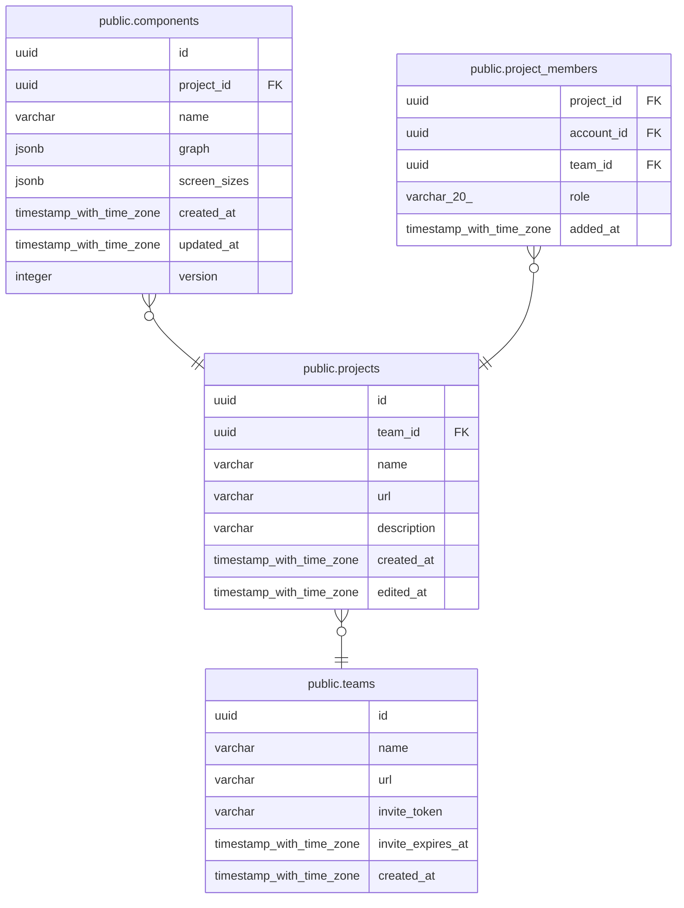

# public.projects

## Columns

| Name | Type | Default | Nullable | Children | Parents |
| ---- | ---- | ------- | -------- | -------- | ------- |
| id | uuid | uuidv7() | false | [public.components](public.components.md) [public.project_members](public.project_members.md) |  |
| team_id | uuid |  | false | [public.project_members](public.project_members.md) | [public.teams](public.teams.md) |
| name | varchar |  | false |  |  |
| url | varchar |  | false |  |  |
| description | varchar |  | false |  |  |
| created_at | timestamp with time zone | now() | false |  |  |
| edited_at | timestamp with time zone | now() | false |  |  |

## Constraints

| Name | Type | Definition |
| ---- | ---- | ---------- |
| ck_projects_description_length | CHECK | CHECK ((char_length((description)::text) <= 500)) |
| ck_projects_name_length | CHECK | CHECK ((char_length((name)::text) <= 100)) |
| ck_projects_name_no_control_characters | CHECK | CHECK (((name)::text !~ '[[:cntrl:]]'::text)) |
| ck_projects_name_not_blank | CHECK | CHECK ((btrim((name)::text) <> ''::text)) |
| ck_projects_url_format | CHECK | CHECK (((url)::text ~ '^[a-z0-9]+(-[a-z0-9]+)*$'::text)) |
| ck_projects_url_length | CHECK | CHECK ((char_length((url)::text) <= 60)) |
| ck_projects_url_not_reserved | CHECK | CHECK (((url)::text <> ALL ((ARRAY['members'::character varying, 'new'::character varying, 'settings'::character varying])::text[]))) |
| projects_created_at_not_null | n | NOT NULL created_at |
| projects_description_not_null | n | NOT NULL description |
| projects_edited_at_not_null | n | NOT NULL edited_at |
| projects_id_not_null | n | NOT NULL id |
| projects_name_not_null | n | NOT NULL name |
| projects_team_id_not_null | n | NOT NULL team_id |
| projects_url_not_null | n | NOT NULL url |
| fk_projects_team_id_teams | FOREIGN KEY | FOREIGN KEY (team_id) REFERENCES teams(id) ON DELETE CASCADE |
| pk_projects | PRIMARY KEY | PRIMARY KEY (id) |
| uq_projects_id_team_id | UNIQUE | UNIQUE (id, team_id) |
| uq_projects_team_id_url | UNIQUE | UNIQUE (team_id, url) |

## Indexes

| Name | Definition |
| ---- | ---------- |
| pk_projects | CREATE UNIQUE INDEX pk_projects ON public.projects USING btree (id) |
| uq_projects_id_team_id | CREATE UNIQUE INDEX uq_projects_id_team_id ON public.projects USING btree (id, team_id) |
| uq_projects_team_id_url | CREATE UNIQUE INDEX uq_projects_team_id_url ON public.projects USING btree (team_id, url) |

## Relations

---

> Generated by [tbls](https://github.com/k1LoW/tbls)
