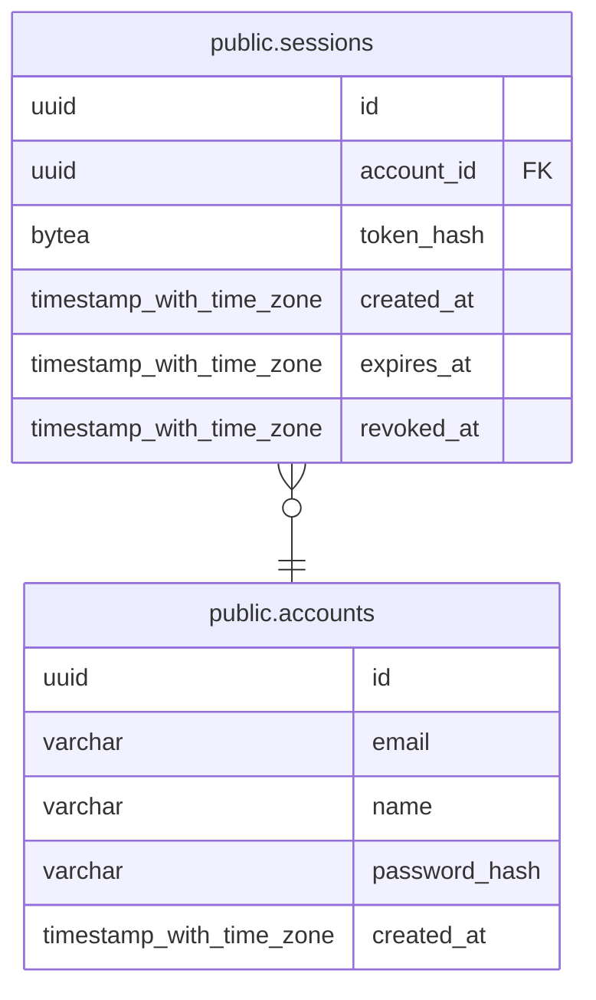

# public.sessions

## Columns

| Name | Type | Default | Nullable | Parents |
| ---- | ---- | ------- | -------- | ------- |
| id | uuid | uuidv7() | false |  |
| account_id | uuid |  | false | [public.accounts](public.accounts.md) |
| token_hash | bytea |  | false |  |
| created_at | timestamp with time zone | now() | false |  |
| expires_at | timestamp with time zone |  | false |  |
| revoked_at | timestamp with time zone |  | true |  |

## Constraints

| Name | Type | Definition |
| ---- | ---- | ---------- |
| ck_sessions_expires_after_created | CHECK | CHECK ((expires_at > created_at)) |
| ck_sessions_token_hash_sha256 | CHECK | CHECK ((octet_length(token_hash) = 32)) |
| sessions_account_id_not_null | n | NOT NULL account_id |
| sessions_created_at_not_null | n | NOT NULL created_at |
| sessions_expires_at_not_null | n | NOT NULL expires_at |
| sessions_id_not_null | n | NOT NULL id |
| sessions_token_hash_not_null | n | NOT NULL token_hash |
| fk_sessions_account_id_accounts | FOREIGN KEY | FOREIGN KEY (account_id) REFERENCES accounts(id) ON DELETE CASCADE |
| pk_sessions | PRIMARY KEY | PRIMARY KEY (id) |
| uq_sessions_token_hash | UNIQUE | UNIQUE (token_hash) |

## Indexes

| Name | Definition |
| ---- | ---------- |
| pk_sessions | CREATE UNIQUE INDEX pk_sessions ON public.sessions USING btree (id) |
| uq_sessions_token_hash | CREATE UNIQUE INDEX uq_sessions_token_hash ON public.sessions USING btree (token_hash) |
| ix_sessions_account_id | CREATE INDEX ix_sessions_account_id ON public.sessions USING btree (account_id) |

## Relations

---

> Generated by [tbls](https://github.com/k1LoW/tbls)
