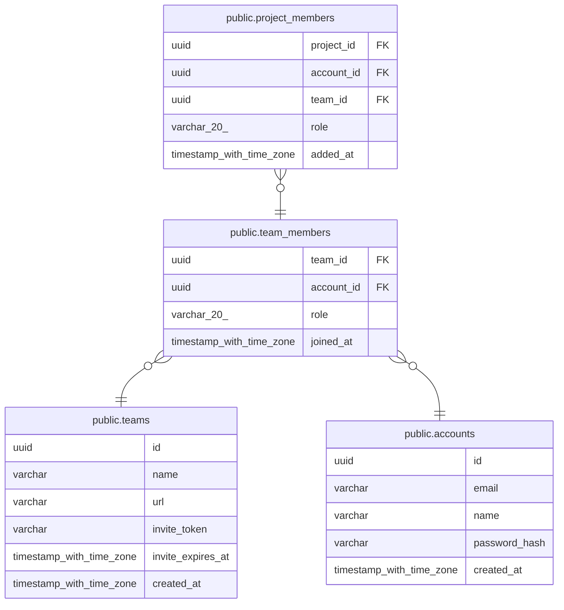

# public.team_members

## Columns

| Name | Type | Default | Nullable | Children | Parents |
| ---- | ---- | ------- | -------- | -------- | ------- |
| team_id | uuid |  | false | [public.project_members](public.project_members.md) | [public.teams](public.teams.md) |
| account_id | uuid |  | false | [public.project_members](public.project_members.md) | [public.accounts](public.accounts.md) |
| role | varchar(20) |  | false |  |  |
| joined_at | timestamp with time zone | now() | false |  |  |

## Constraints

| Name | Type | Definition |
| ---- | ---- | ---------- |
| ck_team_members_role | CHECK | CHECK (((role)::text = ANY ((ARRAY['OWNER'::character varying, 'MEMBER'::character varying])::text[]))) |
| team_members_account_id_not_null | n | NOT NULL account_id |
| team_members_joined_at_not_null | n | NOT NULL joined_at |
| team_members_role_not_null | n | NOT NULL role |
| team_members_team_id_not_null | n | NOT NULL team_id |
| fk_team_members_account_id_accounts | FOREIGN KEY | FOREIGN KEY (account_id) REFERENCES accounts(id) ON DELETE RESTRICT |
| fk_team_members_team_id_teams | FOREIGN KEY | FOREIGN KEY (team_id) REFERENCES teams(id) ON DELETE CASCADE |
| pk_team_members | PRIMARY KEY | PRIMARY KEY (team_id, account_id) |

## Indexes

| Name | Definition |
| ---- | ---------- |
| pk_team_members | CREATE UNIQUE INDEX pk_team_members ON public.team_members USING btree (team_id, account_id) |
| ix_team_members_account_id | CREATE INDEX ix_team_members_account_id ON public.team_members USING btree (account_id) |

## Relations

---

> Generated by [tbls](https://github.com/k1LoW/tbls)
