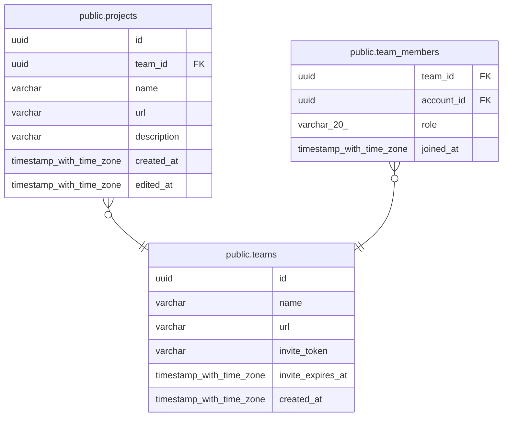

# public.teams

## Columns

| Name | Type | Default | Nullable | Children |
| ---- | ---- | ------- | -------- | -------- |
| id | uuid | uuidv7() | false | [public.projects](public.projects.md) [public.team_members](public.team_members.md) |
| name | varchar |  | false |  |
| url | varchar |  | false |  |
| invite_token | varchar |  | false |  |
| invite_expires_at | timestamp with time zone |  | false |  |
| created_at | timestamp with time zone | now() | false |  |

## Constraints

| Name | Type | Definition |
| ---- | ---- | ---------- |
| ck_teams_invite_token_length | CHECK | CHECK ((char_length((invite_token)::text) >= 22)) |
| ck_teams_name_not_blank | CHECK | CHECK ((btrim((name)::text) <> ''::text)) |
| ck_teams_url_format | CHECK | CHECK (((url)::text ~ '^[a-z0-9]+(-[a-z0-9]+)*$'::text)) |
| ck_teams_url_length | CHECK | CHECK (((char_length((url)::text) >= 3) AND (char_length((url)::text) <= 39))) |
| ck_teams_url_not_reserved | CHECK | CHECK (((url)::text <> ALL ((ARRAY['about'::character varying, 'account'::character varying, 'admin'::character varying, 'api'::character varying, 'app'::character varying, 'assets'::character varying, 'auth'::character varying, 'blog'::character varying, 'contact'::character varying, 'dashboard'::character varying, 'docs'::character varying, 'help'::character varying, 'home'::character varying, 'invite'::character varying, 'join'::character varying, 'legal'::character varying, 'library'::character varying, 'login'::character varying, 'logout'::character varying, 'new'::character varying, 'pricing'::character varying, 'privacy'::character varying, 'projects'::character varying, 'security'::character varying, 'settings'::character varying, 'share'::character varying, 'sign-in'::character varying, 'sign-out'::character varying, 'sign-up'::character varying, 'signin'::character varying, 'signout'::character varying, 'signup'::character varying, 'static'::character varying, 'status'::character varying, 'support'::character varying, 'team'::character varying, 'teams'::character varying, 'terms'::character varying, 'www'::character varying])::text[]))) |
| teams_created_at_not_null | n | NOT NULL created_at |
| teams_id_not_null | n | NOT NULL id |
| teams_invite_expires_at_not_null | n | NOT NULL invite_expires_at |
| teams_invite_token_not_null | n | NOT NULL invite_token |
| teams_name_not_null | n | NOT NULL name |
| teams_url_not_null | n | NOT NULL url |
| pk_teams | PRIMARY KEY | PRIMARY KEY (id) |
| uq_teams_invite_token | UNIQUE | UNIQUE (invite_token) |
| uq_teams_url | UNIQUE | UNIQUE (url) |

## Indexes

| Name | Definition |
| ---- | ---------- |
| pk_teams | CREATE UNIQUE INDEX pk_teams ON public.teams USING btree (id) |
| uq_teams_invite_token | CREATE UNIQUE INDEX uq_teams_invite_token ON public.teams USING btree (invite_token) |
| uq_teams_url | CREATE UNIQUE INDEX uq_teams_url ON public.teams USING btree (url) |

## Relations

---

> Generated by [tbls](https://github.com/k1LoW/tbls)
